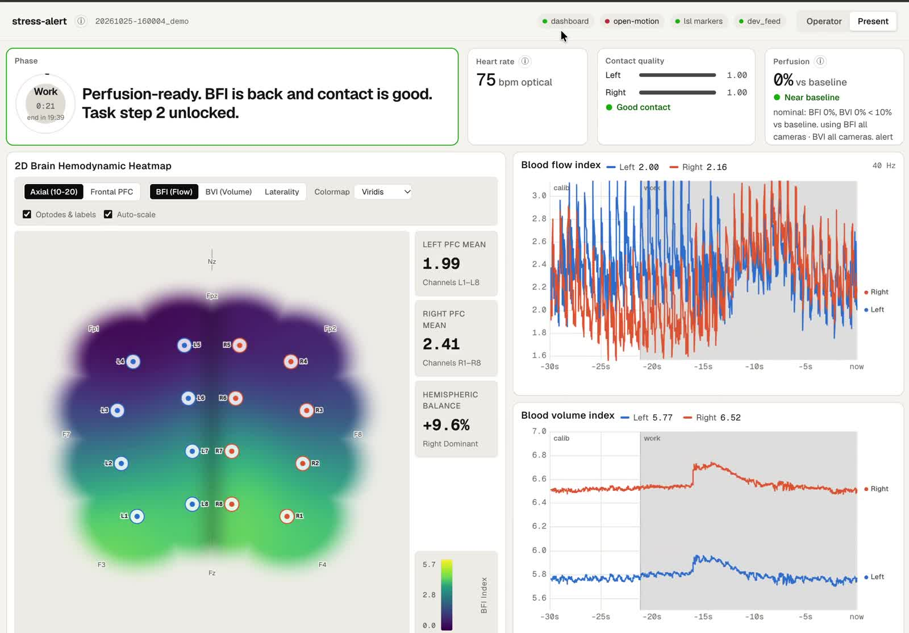

# stress-alert

A closed-loop recovery gate for research. Open-Motion on the forehead reads blood flow and blood volume. A short calibration learns resting flow, and the next task unlocks when that flow has returned and contact is still good.

Raymond Mak (UC Berkeley EECS) and Liam Lenh. Neurotech@Berkeley × Openwater, October 24 to 25, 2026. For research. Not a diagnosis, a screening result, or a treatment signal.

## Problem

The next piece of work should wait until forehead blood flow has settled and the sensor is still coupled. stress-alert is that gate. The signal is optical: blood flow index (BFI) and blood volume index (BVI) from Open-Motion, plus contact quality and a pulse estimate taken from the BFI trace.

## Approach

Calibrate is a short quiet sit. Each camera stores its resting BFI while contact quality is at least 0.50, and the task stays locked. An optional breath-hold is calibration proof of how that flow returns.

Work is the session, 20 minutes by default. The gate opens when forehead BFI is back within the recovery boundary (default 5% of baseline, allowed 1% to 25%) and contact quality is still at least 0.50. When flow leaves that baseline and contact is still good, a breath coach starts on its own and stops once the average flow returns. Bad contact keeps the gate shut and does not start a breath. If blood volume is still high, the step eases or the banner asks for a break. The perfusion tile is secondary telemetry. It does not unlock the task.

## Demo

Present view, 44 seconds, no audio. The sample replay is running. Calibrate learns resting forehead flow with the task locked. Work holds the step until BFI is back and contact is good, then the gate opens.

<video src="docs/demo/present.mp4" controls muted playsinline preload="metadata" poster="docs/demo/present.jpg" width="800">
  <a href="docs/demo/present.mp4">Play the Present-view demo</a>
</video>

[](docs/demo/present.mp4)

From a clone of this repository:

```bash
uv sync --locked
uv run python -m dashboard --dev-feed
```

Open http://127.0.0.1:8765. `--dev-feed` starts Demo Mode at launch. It loops `data/sample_scan.csv` in process: 8 cameras on the left and 8 on the right, BFI and BVI, at 40 Hz, with that file's contact labels. Optical heart rate is estimated from the BFI pulse. The **Demo Mode** button starts the same replay if you launch without the flag, and it reads **Stop Demo** while the replay is running. The replay does not start a session and does not run the phase timer. Press **Run timed** while it is playing to walk calibrate, then work, then the automatic breath. **Present** hides the operator controls. The heatmap and both charts keep moving.

Without Demo Mode or `--dev-feed`, the dashboard waits for a producer on `ws://127.0.0.1:8765/ws/ingest`.

## Live device

The station path uses Openwater's USB cable and `openmotion-sdk==1.12.0`, already pinned. On macOS, `brew install libusb` once.

1. Power the console, connect the sensor modules, start the dashboard, and press **Search**.
2. **Start scan** is the only control that turns the laser on. Live BFI, BVI, and contact quality fill the charts. **Stop scan** ends it. Scan CSVs go to `sessions/device-scans/`, which is gitignored.
3. **Run timed** starts the session: 20 seconds of baseline, hold off unless you set one, then 20 minutes of work.

Demo Mode returns an error while a scan is running. **Start scan** stops the replay first, so the sample file cannot overwrite headset samples.

Do not open the console or change optical output. Organizers allowed team members to wear Open-Motion for this project. Recordings stay in `sessions/` and are not committed.

## Architecture

Producers talk to the dashboard only through [dashboard/SCHEMA.md](dashboard/SCHEMA.md). Frame time `t` is `pylsl.local_clock()` on the dashboard machine.

| Lane | Paths |
| :- | :- |
| Dashboard and session logger | `dashboard/`, `session/` |
| Ingest, features, sync | `ingest/`, `features/`, `sync/` |

Contact quality, the optical heart-rate estimate, and the recovery gate live under `features/`. Replaying a corrected scan CSV offline is `replay_csv.py`. The breath-hold writeup is [protocol/breathhold.md](protocol/breathhold.md).

## Status

The server, live charts, session logger, contact quality, optical heart rate, perfusion tile, and recovery gate run on a live scan and on the sample replay. Calibration learns resting BFI. During work, the step unlocks when forehead BFI has returned and contact quality is at least 0.50.

## Hackathon context

Notes from the October 2026 weekend, including the Open-Motion reference and snapshots of the planning documents, live under [docs/hackathon/](docs/HACKATHON.md).

## For contributors

- Contract: [dashboard/SCHEMA.md](dashboard/SCHEMA.md)
- Spoken demo: [docs/DEMO_SCRIPT_60S.md](docs/DEMO_SCRIPT_60S.md)
- Devpost draft: [docs/DEVPOST_DRAFT.md](docs/DEVPOST_DRAFT.md)
- Sample data: [data/README.md](data/README.md)

```bash
uv run pytest
uv run ruff check .
uv run ruff format --check .
```

Python 3.12. Dependencies are pinned in `pyproject.toml` and locked in `uv.lock`.
